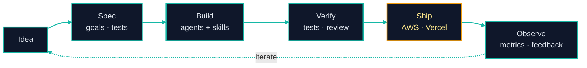
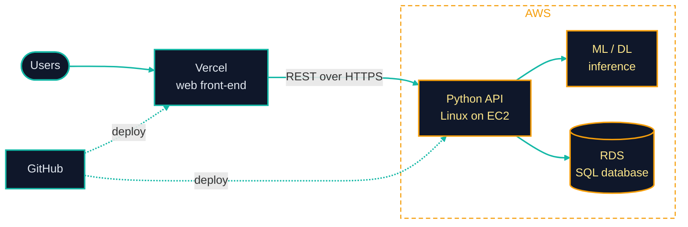

### I turn ideas into deployed AI products.

AI Engineer with a Data Science background. I practice **agentic engineering**: directing AI coding agents with specs, tests and review to take a problem from idea to a running product on AWS and Vercel, without lowering the engineering bar. A model only matters once it ships inside a well-designed system, so that is where I spend my time.

<table>
  <tr><td width="160"><b>Role</b></td><td>AI Engineer · Data Science background</td></tr>
  <tr><td><b>Builds</b></td><td>End-to-end AI products: models, APIs, dashboards, deployment</td></tr>
  <tr><td><b>Agent toolchain</b></td><td>Claude Code · OpenCode · Antigravity · Agent Skills</td></tr>
  <tr><td><b>Runs on</b></td><td>AWS (EC2, RDS) · Linux · Vercel</td></tr>
  <tr><td><b>Core</b></td><td>Python · Machine Learning · Deep Learning · SQL</td></tr>
</table>

> [!TIP]
> **Open to AI Engineer roles**: applied ML, AI-powered products and AI-focused backend work. [Email me](mailto:irulappan8720@gmail.com) or [connect on LinkedIn](https://www.linkedin.com/in/irulappan-t-b69413279).

## 01 · Idea → Product

Every project runs the same loop. Agents speed up the build; specs, tests and review keep it production-grade.

## 02 · Shipped

<!-- Add a repo or demo link to each row, e.g. [repo](https://github.com/irulappant/<repo-name>) -->

| Project | Approach | Outcome |
|:--|:--|:--|
| **Paddy Leaf Disease Detection** `computer vision` | Hybrid CNN + LSTM: CNN for spatial features, LSTM for temporal awareness. Multi-class dataset, preprocessing pipeline and cross-validation. | **98% accuracy.** Inference pipeline designed for edge devices, built for scalable crop monitoring. |
| **Phishing Website Detection** `cybersecurity` | Deep learning URL classifier fed by a multi-stage, feature-rich preprocessing pipeline. | Built for real-time phishing detection and stronger cyber threat protection. |
| **Heart Disease Prediction** `healthcare` | Hybrid ensemble ML with clinical validation and interpretable predictions. | Decision support for clinicians. |
| **Performance Analytics Platform** `analytics` | SQL-first analytics backend feeding Power BI KPI dashboards for leadership. | Actionable insight for data-driven decisions, not just charts. |
| **ERP and LMS Platforms** `enterprise` | Python backend with RBAC, workflow-driven approvals, audit trails and multi-module dashboards. | Governed, multi-role academic and enterprise systems. |

<b>Deep dive: Paddy Leaf Disease Detection</b>

- **Architecture:** CNN for spatial features, LSTM for temporal patterns
- **Data:** multi-class paddy disease images with a preprocessing pipeline
- **Deployment:** designed for edge-device inference
- **Validation:** cross-validation plus real-world test scenarios

## 03 · Stack

The default shape of what I ship:

<!-- Remove any tool you have not used in a real project. -->

| Layer | Tools |
|:--|:--|
| **Agentic development** | <kbd>Claude Code</kbd> <kbd>OpenCode</kbd> <kbd>Antigravity</kbd> <kbd>Agent Skills</kbd> <kbd>Prompt engineering</kbd> <kbd>Context engineering</kbd> |
| **AI / ML / DL** | <kbd>Python</kbd> <kbd>TensorFlow</kbd> <kbd>Keras</kbd> <kbd>scikit-learn</kbd> <kbd>Pandas</kbd> <kbd>NumPy</kbd> |
| **Techniques** | <kbd>CNN</kbd> <kbd>LSTM</kbd> <kbd>Hybrid models</kbd> <kbd>NLP</kbd> <kbd>Computer vision</kbd> <kbd>Predictive analytics</kbd> |
| **Backend** | <kbd>FastAPI</kbd> <kbd>REST APIs</kbd> <kbd>SQL</kbd> <kbd>RBAC</kbd> <kbd>Audit trails</kbd> |
| **Cloud and Linux** | <kbd>AWS EC2</kbd> <kbd>AWS RDS</kbd> <kbd>S3</kbd> <kbd>IAM</kbd> <kbd>Linux</kbd> <kbd>Bash</kbd> <kbd>Nginx</kbd> |
| **Delivery** | <kbd>Vercel</kbd> <kbd>Docker</kbd> <kbd>GitHub Actions</kbd> <kbd>Git</kbd> |
| **Data and BI** | <kbd>SQL</kbd> <kbd>Power BI</kbd> <kbd>Jupyter</kbd> <kbd>KPI design</kbd> |

## 04 · Agentic engineering, in practice

> [!NOTE]
> Agents write code fast. I stay accountable for what ships: correctness, security and cost.

1. **Spec first.** Goals, constraints and acceptance tests exist before the first prompt.
2. **Agents draft, I decide.** Every change is reviewed, and tests and evals decide what merges.
3. **Skills, not repetition.** Conventions, scaffolds and deploy checklists live in reusable Agent Skills.
4. **Ship small, ship early.** A real Linux server, a real database and a real URL, then iterate on feedback.
5. **Governance by default.** RBAC, audit trails and least-privilege access are designed in, not bolted on.

## 05 · Now and next

- [x] Agentic development with Claude Code, OpenCode and Antigravity
- [x] Deploying on AWS (EC2 and RDS) and Vercel
- [x] Deep learning: CNN, LSTM and hybrid architectures
- [ ] LLM applications and RAG pipelines in production
- [ ] Agent workflows and evaluation
- [ ] PySpark for large-scale data processing
- [ ] MLOps: production ML pipelines, monitoring and microservices

## 06 · Background

- **Master of Data Science** · The American College
- **Bachelor of Computer Applications** · Mannar Thirumalai Naicker College

## 07 · Let's build

Have an AI product that needs to go from idea to production? Let's talk.

*Built with agents. Reviewed by a human. Shipped to production.*
